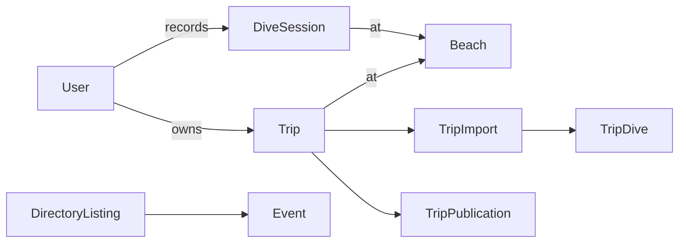

# Finfolk database design

FinfolkDB is a PostgreSQL database authored in Clojure, organised around people,
places, and their activities. Reusable infrastructure—revision history,
auditing, access, and social identities—is attached through `et/E`.

This walkthrough covers the current 93-table native source schema. Generating
that schema and installing it are separate operations.

## Main business relationships



`User` and `Beach` are important anchors:

- **User** represents an application member. Connections, blocks, check-ins,
  trips, and logbook entries refer to it.
- **Beach** is the stable identity of a dive location. Its profile, proposed
  revisions, access points, environmental evidence, and community notes live in
  related tables.
- **DirectoryListing** represents a claimable directory page. Its owners and
  administrators are access roles; events belong to listings.

All native entity IDs are UUIDs. Provider identifiers, slugs, and imported keys
remain separate business fields.

## Entity structure through et/E

For example, Trip uses:

```clojure
(et/E {:class  :0d/entry
       :addons [:detail :rev :audit]})
```

That declaration combines a normal entity with:

| Element | Responsibility |
| --- | --- |
| UUID identity | Identifies the Trip |
| Tracking | Records creation/update operations and times |
| `detail` | Holds the editable JSON document |
| `rev` | Links to its revision stream |
| `audit` | Links to its audit stream |

The authored Trip fields then describe its business relationships: owner,
beach, start date, and end date. See the
[Trip declarations](../src/finfolkdb/common/type_trip_base.clj).

The class names describe structure:

- `:0d/entry`: an ordinary domain entity.
- `:1d/base`: a reusable provider scoped by entity class.
- `:2d/base`: a provider scoped by entity class and context.
- `:entry` and `:log` children can belong to those providers.

For example, a revision stream can identify its subject through:

```text
class-table   = Trip
class-context = Global
class-ref     = <Trip UUID>
```

Some scoped tables consequently have composite primary keys containing a UUID
plus scope columns.

## Operations, revisions, and audits

The shared infrastructure is in
[type_system_base.clj](../src/finfolkdb/common/type_system_base.clj).

| Records | Question answered |
| --- | --- |
| `Op` | Which operation happened, when, and for which user? |
| `Rev` / `RevLog` | What version is this entity, and what changed? |
| `Audit` / `AuditLog` | What actions or decisions happened to it? |
| `Activity` / `ActivityLog` | What activity should be associated with it? |

Creating a Trip creates its initial revision and audit records alongside the
Trip. Those writes occur in the caller's transaction, so a failure rolls the
whole creation back.

Timestamps use Unix epoch microseconds stored as `BIGINT`. Calendar values such
as trip dates remain PostgreSQL `DATE`s.

There is still a consistency issue in Finfolk's declarations: several tables
explicitly disable tracking with `:track/none` and declare their own time
fields. Other entries use the generated tracking convention.

## Private trips and public publication

Trips keep separate records for private work and public publication:

```text
Trip                 private editable draft
TripImport           one import attempt
TripImportBatch      uploaded chunks
TripDive             individual imported rows
TripPublication      independently stored publication snapshot
```

A completed import can become the active import. Publishing creates a snapshot
with explicit consent and publication status.

Editing the private Trip does not silently rewrite its published snapshot. Raw
dive data, draft editing, and public presentation have separate records and
lifecycles.

There are also two kinds of revisioning: generic `Rev` infrastructure tracks
entity edits, while records such as `SiteRevision` represent a feature-specific
proposal and review workflow.

## Other table families

| Area | Main purpose |
| --- | --- |
| Sites | `SiteProfile`, `SiteRevision`, access points, depth evidence, and notes |
| Reference data | Sources, assets, datasets, geographic features, boundaries, and release manifests |
| Environment | Provider targets, retained snapshots, freshness windows, and leased jobs |
| Directory and events | Listings, ownership claims, invitations, events, and RSVPs |
| Social | Provider connections, handles, imported posts, discovery, and moderation |
| Messaging | Accounts, identities, conversations, messages, processing receipts, and outbound delivery |
| Rewards and shop | Invitations, points entries, wallets, items, and redemptions |

Messaging separates receiving a provider event, processing it, and delivering a
response. Receipts, leases, retries, and an outbox give each stage explicit state.

## Typed relationships and flexible JSON content

Ownership, references, dates, statuses, and uniqueness rules generally live in
typed columns.

Flexible documents live in JSONB: profiles, listing descriptions, trip stories,
provider payloads, and dataset metadata.

For example, Trip stores `beach`, `start-date`, and `end-date` as typed fields and
removes their duplicate API properties from `detail`. That gives the database
enforceable relationships while keeping the editable document flexible.

The tradeoff is that JSON content needs validation in the database functions or
application boundary; its structure is less explicit than ordinary columns.

## Database operations and permissions

The main division is:

```text
finfolk       tables and shared helper functions
finfolk_rpc   application operations and projections
```

The trusted server supplies the authenticated actor through transaction-local
context. Functions then check ownership, visibility, blocking, or role membership.

`Access`, `AccessRole`, requests, and invitations provide reusable application
permissions. Separate PostgreSQL grants control what directory, messaging, and
notes workers can execute. Not every table receives equivalent protection from
its entity declaration alone.

## Authoring and testing

```text
Clojure declarations and functions
              ↓
Generated SQL, entity catalog, and RPC catalog
              ↓
Installation and verification in a test database
```

The [database build entrypoint](../src/finfolkdb/build.clj) publishes those
artifacts without connecting to a database. Local Supabase supplies the test
server, with disposable databases for individual suites.

A useful next walkthrough is creating and publishing one Trip: it connects the
entity model, operation context, revision history, imports, privacy, and
publication rules in one concrete flow.
